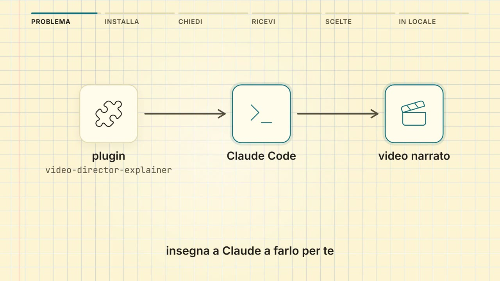

# video-director-explainer

**Versione 1.0.1**, vedi il [changelog](CHANGELOG.md) (in inglese). [English](README.md) | Italiano

[](media/video-director-explainer-it.mp4)

*Clicca l'immagine per guardare il video (83 s, con audio). L'ha fatto il
plugin stesso, a partire da questo README e dalla documentazione del plugin.*

Un plugin di Claude Code che insegna a Claude a fare un **breve video
esplicativo narrato** a partire dai fatti: un how-to DevOps ("come abbiamo
risolto X"), il resoconto di un lavoro fatto o la spiegazione di un task da
fare. Chiedi un video; Claude raccoglie i fatti, scrive la narrazione, la
registra con una voce locale, disegna le inquadrature, le controlla su
fotogrammi, fa il render di un MP4 (16:9, 9:16 o 1:1, 1080 px sul lato corto)
con musica tranquilla ed effetti sonori generati sulla tua macchina e, se
vuoi, scrive accanto una pagina HTML con i comandi.

```
tu:      fai un video che spiega come abbiamo risolto il crash del checkout dopo il deploy 2.4.0
claude:  facts.md -> narrazione (il tuo OK) -> voce -> storyboard -> fotogrammi -> render
         videos/checkout-crashloop/out/checkout-crashloop.mp4    (86 s, 16:9, 1080p)
         videos/checkout-crashloop/out/checkout-crashloop.html   (sintesi, comandi, trascrizione)
         videos/checkout-crashloop/OUTCOME.md                    (tempi, controlli, cosa non è stato controllato)
```

Tutto gira sulla tua macchina: nessuna chiave API, nessuna voce nel cloud,
nessuna musica di repertorio, niente caricato online, nessun diritto di
amministratore.

## Com'è fatto un video

Lo stile viene da video di prova fatti su uno stesso brief, una spiegazione
di 90 secondi; le regole sono in
[`skills/make/references/style.md`](plugins/video-director-explainer/skills/make/references/style.md)
(in inglese). In breve:

- **un soggetto per inquadratura, grande**: un terminale che occupa il
  fotogramma, un diagramma di 2-4 nodi, una scheda di stato, un numero;
  niente sotto i 28 px (terminali e codice 24 px nei formati stretti);
- **qualcosa cambia sulla parola detta che lo nomina**, circa ogni 2
  secondi: un comando si scrive, una riga si mette tra parentesi, una spunta
  si disegna;
- un movimento lento di camera su ogni inquadratura, su **carta a
  quadretti**: una carta chiara per i concetti (un blocco giallo di default,
  altre sette a scelta) e una nera sbiadita per i dettagli e la lezione
  finale, con una dissolvenza tra le due;
- **tre formati**: 16:9 per le spiegazioni e i comandi lunghi, 9:16 per un
  video breve da telefono, 1:1 per una clip da incollare in una chat; Claude
  lo sceglie dal soggetto, a meno che tu non ne chieda uno;
- una **barra dei capitoli** in alto, dove ogni capitolo è sempre visibile e
  quello corrente si riempie mentre scorre; con molti capitoli, due righe (le
  parti sotto, i capitoli della parte corrente sopra);
- **sottotitoli** brevi, con i termini esatti, i comandi e i nomi in un font
  da codice (`kubectl`, `DATABASE_URL`);
- una narrazione con i **termini inglesi pronunciati in inglese** dentro
  un'altra lingua, dalla stessa voce locale;
- **musica tranquilla** sotto la voce, in uno stile che Claude sceglie dal
  soggetto, che cambia a ogni capitolo e finisce con il filmato, e pochi
  **effetti sonori** (un cambio di capitolo, l'errore, il controllo che
  passa), solo nelle pause della narrazione, mai sopra una parola;
- il sintomo della prima inquadratura torna risolto alla fine.

## Installazione

Da GitHub:

```
/plugin marketplace add LairdLuca/video-director-explainer
/plugin install video-director-explainer@video-director-explainer
```

Da un clone locale: `/plugin marketplace add <path del clone>`, poi la stessa
riga `install`.

Poi lancia il setup una volta:

```
/video-director-explainer:setup
```

Controlla la macchina, prepara a livello utente il runtime della voce e i
modelli, e fa alcune domande, una alla volta, ognuna con un default. Ogni
scelta è una chiave della configurazione del plugin:

| Chiave | Scelta | Default |
|---|---|---|
| `language` | Lingua della narrazione e del testo a schermo | `it` (anche `en`, `en-gb`, `es`, `fr`, `pt`; solo l'italiano è testato) |
| `voice` | Voce, con un campione di 5 secondi per ogni candidata | il default della lingua (`im_nicola` per l'italiano) |
| `captions` | Sottotitoli | sì |
| `page` | Pagina HTML accanto a ogni video | sì |
| `openOnDelivery` | Apre da sola la pagina (o l'MP4) quando il video è pronto | sì |
| `checkpoints` | Dove la produzione si ferma per il tuo OK | `narration` (anche `none`, `narration+preview`) |
| `videosDir` | Cartella dei progetti video | `videos` nel tuo progetto |
| `paletteLight` | Carta della scena chiara: `giallo` (blocco giallo), `quaderno`, `milli`, `arancio`, `tecnico`, `rosso`, `verde`, `grigio` | `giallo` |
| `paletteDark` | Carta della scena scura: `notte` (nero sbiadito), `ardesia` | `notte` |
| `font` | Font del testo: Inter, incluso nel plugin, un sans-serif trovato sulla tua macchina o un tuo file di font | `inter` |
| `music` | Musica di sottofondo sotto la narrazione | sì |
| `sfx` | Brevi effetti sonori ai cambi di capitolo e nei momenti chiave | sì |
| `audioDir` | Una tua cartella di musica ed effetti, usata al posto di quelli generati | nessuna |
| `format` | Non chiesto: 16:9, 9:16 o 1:1, scelto per ogni video dal soggetto | `auto` |
| `musicStyle` | Non chiesto: `warm`, `pulse` o `minimal`, scelto per ogni video dal soggetto | `auto` |
| `musicLevel` | Non chiesto: la musica sotto la voce, `high` (16 LU sotto), `normal` (20) o `low` (24) | `high` |
| `engine` | Non chiesto: la voce locale Kokoro, l'unico motore | `kokoro` |
| `speed` | Non chiesto: la velocità della voce, tarata su 2.3-2.7 parole al secondo | quella della voce |
| `resolution` | Non chiesto: 1080 px sul lato corto, in ogni formato | `1080p` |
| `flagDashes` | Non chiesto: dire `--atomic` come "dash dash atomic" invece di "atomic" | no |
| `modelsDir`, `runtimeDir` | I modelli della voce (il setup chiede se li hai già) e il venv Python della fase voce | nella cartella dati del plugin |

Ogni chiave, i suoi valori e le frasi che la cambiano per un solo video sono
in
[`config.md`](plugins/video-director-explainer/skills/setup/references/config.md)
(in inglese). Le risposte sono salvate nella cartella dati del plugin e
restano dopo gli aggiornamenti. Per cambiarle, rilancia il setup. **Ogni
scelta si può cambiare per un solo video** chiedendolo: "senza
sottotitoli", "voce femminile", "niente pagina", "non aprirlo", "in inglese",
"verticale", "senza musica", "musica più bassa", "più ritmo".

## Requisiti

- Claude Code con il supporto ai plugin.
- **Node.js 18 o più recente** e **npm** (ogni progetto video installa i suoi
  pacchetti Remotion, con le versioni fissate, da un lockfile).
- **Python 3.12 o 3.13** per la fase voce (un venv nella cartella dati del
  plugin; la 3.14 non è ancora supportata dai pacchetti con le versioni
  fissate).
- **ffmpeg e ffprobe** nel PATH.
- Circa **3 GB** di disco per il runtime e i modelli (circa 840 MB di
  modelli), più circa **600 MB per progetto video** (soprattutto il browser
  headless di Remotion, scaricato dentro ogni progetto).
- **8 GB di RAM** o più; i render non partono con meno di 2.5 GB liberi.
- Windows x64, Linux x86_64 o aarch64, macOS 14+ su Apple silicon. I Mac
  Intel non sono supportati (la versione fissata di onnxruntime non ha una
  wheel per loro). Durante lo sviluppo è stato usato solo Windows.

Il setup stampa un comando di installazione a livello utente per ogni cosa
che manca (winget, brew, uv) e non lo lancia mai senza chiedere. Niente
richiede diritti di amministratore.

Rete: i pacchetti npm e PyPI e i file dei modelli si scaricano una volta, con
le versioni fissate e controllati con un hash (o riusati da una cartella che
hai già). Dopo il setup la fase voce funziona offline. C'è un altro download
per ogni video: al primo fotogramma, Remotion scarica il suo browser headless
(Chrome Headless Shell, circa 280 MB su disco) dentro il progetto video. La
sua versione è fissata dalla versione di Remotion, e arriva dallo storage
Chrome for Testing di Google (su macOS e sui Linux recenti, da
`remotion.media`, il dominio di Remotion); quel download lo controlla
Remotion, non uno sha256 di questo plugin.

## Come si fa un video

`/video-director-explainer:make`, o semplicemente chiedi un video. I passi:

1. **Fatti** in `facts.md`, ognuno con la sua fonte: la conversazione, git
   (log, diff, commit) o file markdown. Niente viene inventato; una lacuna si
   scrive, non si riempie. Claude sceglie il formato e lo stile della musica
   dal soggetto, a meno che tu non li abbia chiesti.
2. **Narrazione** (`script.json`): 60-90 secondi, un'idea per frase, divisa
   in capitoli. **Checkpoint**: vedi il copione e i capitoli prima che la
   voce venga registrata (a meno che i checkpoint siano `none`).
3. **Voce**: un WAV per frase con Kokoro; un modello Whisper locale ascolta
   ogni frase, dà i tempi delle parole ed elenca i termini inglesi che non ha
   riconosciuto, e Claude li corregge. Comandi, nomi di file e identificatori
   sono marcati come codice per i sottotitoli.
4. **Storyboard** (`storyboard.json`): inquadrature prese da un catalogo di
   nove tipi di scena, ogni cambio visivo agganciato a una parola detta; un
   lint controlla gli agganci, le durate, i limiti di layout del formato
   scelto, dove cadono gli effetti sonori e che ogni comando a schermo sia
   nei fatti.
5. **Fotogrammi**: fogli di provini che Claude legge come immagini, e una
   sonda dei fermi immagine, prima di qualsiasi render completo.
   **Checkpoint** facoltativo: vedi i fotogrammi.
6. **Render**: un solo browser headless su 127.0.0.1, prima un controllo
   della memoria, ogni processo figlio chiuso alla fine; poi musica ed
   effetti vengono generati e mixati sotto la narrazione, e tutto il mix è
   normalizzato a -14 LUFS.
7. **Pagina**: un solo file HTML autonomo accanto all'MP4.
8. **Review finale** di un sub-agente nuovo, confrontata con i fatti; un giro
   di correzioni.
9. **Consegna**: l'MP4, la pagina e `OUTCOME.md` con i tempi di ogni passo e
   quello che non è stato controllato; poi la pagina (o l'MP4) si apre con il
   tuo programma predefinito, a meno che tu non l'abbia disattivato.

Su un portatile da 16 GB, solo CPU, i passi automatici di un video di 90
secondi hanno richiesto circa 15-25 minuti (installazione del progetto 1 min,
voce 2 min, fotogrammi 4 min, sonda dei fermi immagine 4 min, render 5-9 min
a seconda della memoria libera, musica ed effetti pochi secondi), più il
tempo che Claude passa a scrivere. Le prove cronometrate, con la scrittura e
un giro di review, hanno richiesto 42-54 minuti per video.

Un esempio completo (fatti, narrazione con le correzioni di pronuncia e il
lessico, storyboard, dati della pagina) è in
[`plugins/video-director-explainer/examples/acme-shop-crashloop/`](plugins/video-director-explainer/examples/acme-shop-crashloop/).

## Licenza di Remotion

video-director-explainer è MIT. Usa [Remotion](https://www.remotion.dev) per
il render dei video, e **Remotion ha una sua licenza, che non è MIT**.
Remotion è gratuito per i privati, per le aziende a scopo di lucro con al
massimo 3 dipendenti, per le organizzazioni non profit e per la valutazione;
le aziende a scopo di lucro più grandi hanno bisogno di una licenza aziendale
di Remotion. Leggi la [licenza di Remotion](https://www.remotion.dev/license)
prima di usare video-director-explainer al lavoro, e compra una licenza
aziendale se ti riguarda. Il plugin non passa una chiave di licenza, quindi
Remotion non invia nessun evento di utilizzo.

Gli altri componenti di terze parti (font, icone, modelli di voce e di
riconoscimento vocale, pacchetti Python) e le loro licenze sono elencati in
[THIRD_PARTY.md](THIRD_PARTY.md). Musica ed effetti sono fatti dal codice del
plugin; una tua cartella di suoni, e un font della tua macchina, sono da
controllare da te per i diritti. Due punti non sono stati verificati da un
avvocato: il modulo della voce importa `phonemizer`, che è GPL-3.0, e carica
espeak-ng durante l'esecuzione (li installa il setup, questo repository non
li contiene), e `@remotion/transitions` dichiara `UNLICENSED` nel suo
`package.json` e lo si considera coperto dalla licenza di Remotion.

## Limiti noti

- **È stata testata solo la narrazione in italiano**, con le voci
  `im_nicola` e `if_sara`. Le altre lingue hanno voci e frasi di esempio ma
  nessun test.
- **La pronuncia la giudica Whisper, non un orecchio umano.** In un
  prototipo, il 93% dei termini inglesi in frasi italiane è stato
  riconosciuto, su frasi tenute fuori dalla taratura; `on-call` e `rebase`
  fallivano ancora. Gli acronimi hanno bisogno di markup.
- **Solo 1080 px sul lato corto** (16:9, 9:16, 1:1); niente registrazione
  dello schermo, niente pubblicazione. In 9:16 e 1:1 una riga di terminale o
  di codice tiene circa 61 caratteri: i video con righe più lunghe restano
  16:9.
- **Musica ed effetti sono stati misurati, poi ascoltati solo su clip di 20
  secondi**, non ancora in un video intero. Tre stili generati, nessun
  campione al setup.
- **9:16 e 1:1 sono stati controllati su fotogrammi e brevi clip**
  dell'esempio, non ancora in un video completo.
- Le scene **Screenshot** e **Custom** sono state provate solo su dati di
  test.
- Una correzione dopo la review finale vuol dire un **nuovo render
  completo** (circa 5 minuti).
- Ogni progetto video ha i suoi `node_modules` e il suo browser headless
  (circa 600 MB).
- Sviluppato e usato su Windows; i path per macOS e Linux sono scritti ma
  non provati.

## Struttura del repository

```
.claude-plugin/marketplace.json      questo repository è un marketplace con un solo plugin
plugins/video-director-explainer/
  .claude-plugin/plugin.json
  README.md                          come è fatto il plugin (in inglese)
  skills/setup/                      /video-director-explainer:setup
  skills/make/                       /video-director-explainer:make, e i suoi riferimenti
  template/                          il progetto Remotion copiato per ogni video
  scripts/                           script Node: nuovo video, config, font, voce, lint, fotogrammi, fermi immagine, audio, render, pagina, apertura
  voice/                             il modulo Python della voce (Kokoro + Whisper)
  examples/acme-shop-crashloop/      un esempio completo con fatti inventati
media/                               i video in cima a README.md e README.it.md
```

## Licenza

MIT, vedi [LICENSE](LICENSE). Remotion e le altre dipendenze mantengono le
loro licenze: vedi sopra e [THIRD_PARTY.md](THIRD_PARTY.md).
